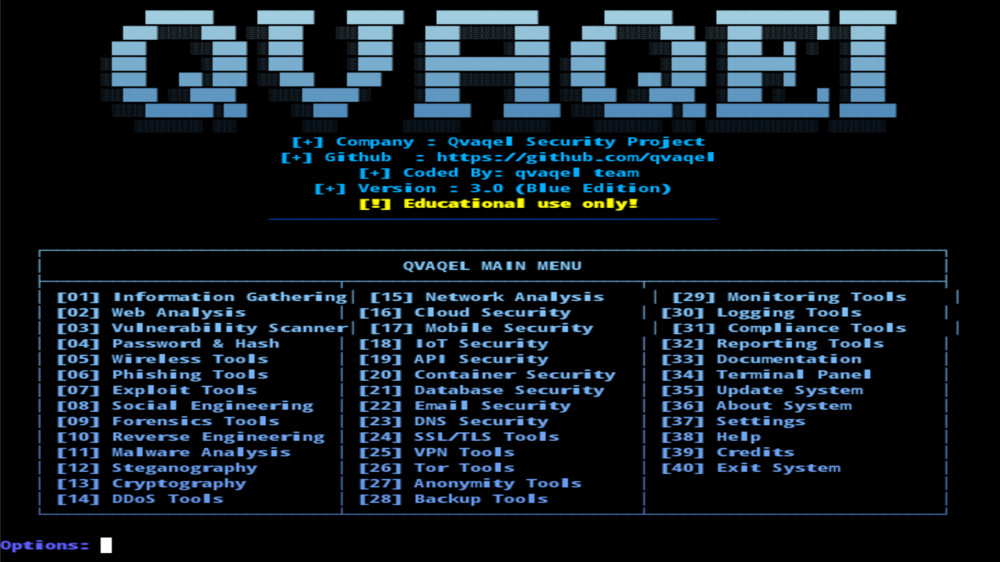

# 🔐 QVAQEL Security Toolkit

<div align="center">



**All-in-One Security Toolkit — Windows | Linux | macOS | Termux**

[](https://www.python.org/)
[](LICENSE)
[]()
[]()
[]()

</div>

---

## 📋 О проекте

**QVAQEL** — это комплексный набор инструментов для тестирования безопасности, работающий на **любой платформе**: Windows (CMD/PowerShell), Linux, macOS и Android (Termux). Включает **40 категорий** и более **300+ инструментов** для пентеста, анализа уязвимостей, OSINT, криптографии и многого другого.

> ⚠️ **Внимание:** Инструмент предназначен только для образовательных целей и тестирования систем, которыми вы владеете или имеете разрешение на тестирование.

---


## 🚀 Возможности (40 категорий)

### 🔍 Разведка и OSINT
| # | Категория | Инструменты |
|---|-----------|-------------|
| 01 | Information Gathering | Nmap, RedHawk, Sherlock, Photon, Seeker, Trape, MaxSubdoFinder, ReconDog |
| 02 | Web Analysis | SQLmap, Nikto, WPScan, Dirb, WhatWeb, XSSer, Burp, OWASP-ZAP |
| 03 | Vulnerability Scanner | Nuclei, Dalfox, Commix, Skipfish, Wapiti, Arachni, Wfuzz, JoomScan |

### 🔑 Аутентификация и пароли
| # | Категория | Инструменты |
|---|-----------|-------------|
| 04 | Password & Hash | John, Hydra, Hashcat, HashID, Crunch, Medusa, Cupp, RSMangler |
| 05 | Wireless Tools | Aircrack-ng, Bettercap, Reaver, Bully, Wifite, Kismet, Fern, Fluxion |
| 06 | Phishing Tools | SocialFish, Zphisher, Gophish, BlackPhish, ShellPhish, SayCheese, PyPhisher, Evilginx |

### 💥 Эксплойты и атаки
| # | Категория | Инструменты |
|---|-----------|-------------|
| 07 | Exploit Tools | Metasploit, SearchSploit, MSFVenom, Routersploit, BeEF, Faraday, ExploitDB, Commix |
| 08 | Social Engineering | SET, KingPhisher, Maltego, Recon-ng, theHarvester, SpiderFoot, Osintgram, Maigret |
| 09 | Forensics Tools | Autopsy, Volatility, Binwalk, Foremost, SleuthKit, Guymager, BulkExtractor, Redline |

### 🔬 Анализ и реверс
| # | Категория | Инструменты |
|---|-----------|-------------|
| 10 | Reverse Engineering | Ghidra, Radare2, Objdump, Cutter, Frida, Ltrace, Strace, IDA-Free |
| 11 | Malware Analysis | YARA, ClamAV, PEfile, Cuckoo, Capa, VirusTotal-API, MalwareBazaar, AnyRun |
| 12 | Steganography | Steghide, Stegsolve, Outguess, Zsteg, ExifTool, Stegano, OpenStego, WbStego |

### 🔐 Криптография и защита
| # | Категория | Инструменты |
|---|-----------|-------------|
| 13 | Cryptography | OpenSSL, GPG, VeraCrypt, Kleopatra, CCrypt, RsaCtfTool, CyberChef, Hashcat |
| 14 | DDoS Tools | LOIC, Slowloris, HULK, Xerxes, GoldenEye, T50, UFONet, Torshammer |
| 15 | Network Analysis | Wireshark, Tcpdump, Netstat, Iptables, Nftables, Suricata, Snort, Zeek |

### ☁️ Облака и контейнеры
| # | Категория | Инструменты |
|---|-----------|-------------|
| 16 | Cloud Security | AWS-CLI, Azure-CLI, GCloud, Terraform, Packer, Ansible, Docker, Kubectl |
| 17 | Mobile Security | MobSF, APKTool, Jadx, Frida-Mobile, Drozer, Androguard, Objection, Magisk |
| 18 | IoT Security | Firmware-Analysis, RouterSploit, Zigbee-Tools, BLE-Tools, MQTT-Tools, CoAP-Tools |
| 19 | API Security | Postman, Insomnia, Swagger, OWASP-API, Kong, Tyk, Apigee, 3scale |
| 20 | Container Security | Docker-Sec, Kubernetes-Sec, Falco, Trivy, Clair, Anchore, Sysdig, Neuvector |

### 🗄️ Базы данных и почта
| # | Категория | Инструменты |
|---|-----------|-------------|
| 21 | Database Security | SQLmap, NoSQLMap, DBPwAudit, Odat, Mongodump, PgDump, MySQL-Audit, Redis-Tools |
| 22 | Email Security | Modlishka, Email-Spoofer, SMTP-Tester, MailSniper, Gophish, KingPhisher, Email-Harvester |
| 23 | DNS Security | DNSRecon, DNSScan, Sublist3r, Amass, MassDNS, Fierce, DNSenum, DNSmap |
| 24 | SSL/TLS Tools | SSLScan, TestSSL, SSLLabs, OpenSSL-Tools, Certbot, LetsEncrypt, SSLyze, TLS-Scanner |

### 🌐 Сети и анонимность
| # | Категория | Инструменты |
|---|-----------|-------------|
| 25 | VPN Tools | OpenVPN, WireGuard, StrongSwan, SoftEther, Pritunl, ZeroTier, Tailscale, NetBird |
| 26 | Tor Tools | Tor, TorBrowser, OnionScan, OnionShare, Ricochet, Whonix, Tails, SubgraphOS |
| 27 | Anonymity Tools | Proxychains, Torify, Anonsurf, MAC-Changer, SpoofMAC, VPN-Auto, DNS-Leak, WebRTC-Leak |

### 📊 Мониторинг и логирование
| # | Категория | Инструменты |
|---|-----------|-------------|
| 28 | Backup Tools | Rsync, Borg, Restic, Duplicati, Timeshift, Deja-Dup, BackInTime, Amanda |
| 29 | Monitoring Tools | Nagios, Zabbix, Prometheus, Grafana, Datadog, NewRelic, Sentry, PagerDuty |
| 30 | Logging Tools | ELK-Stack, Splunk, Graylog, Fluentd, Logstash, Kibana, Loki, Promtail |

### ✅ Compliance и отчёты
| # | Категория | Инструменты |
|---|-----------|-------------|
| 31 | Compliance Tools | OpenSCAP, CIS-CAT, Lynis, OSSEC, Wazuh, Tripwire, AIDE, Samhain |
| 32 | Reporting Tools | Dradis, Serpico, PwnDoc, Faraday-Report, Ghostwriter, DefectDojo, SecurityNik |
| 33 | Documentation | MkDocs, Sphinx, Docusaurus, GitBook, Notion, Confluence, WikiJS, BookStack |

### ⚙️ Системные функции
| # | Категория | Описание |
|---|-----------|----------|
| 34 | Terminal Panel | Управление системой |
| 35 | Update System | Обновление пакетов |
| 36 | About System | Информация о проекте |
| 37 | Settings | Настройки |
| 38 | Help | Помощь |
| 39 | Credits | Благодарности |
| 40 | Exit System | Выход |

---

## 📦 Установка

### 🪟 Windows (CMD / PowerShell)

**Требования:** Python 3.8+, Git

```cmd
# 1. Установите Python с https://www.python.org/downloads/
#    При установке отметьте "Add Python to PATH"

# 2. Установите Git с https://git-scm.com/download/win

# 3. Откройте CMD или PowerShell и выполните:
git clone https://github.com/qvaqel/qvaqel.git
cd qvaqel
python qvaqel.py
```

**Альтернатива через pip:**
```cmd
pip install qvaqel
qvaqel
```

---

### 🐧 Linux (Ubuntu / Debian / Kali / Arch)

```bash
# Ubuntu / Debian / Kali
sudo apt update
sudo apt install -y python3 python3-pip git

git clone https://github.com/qvaqel/qvaqel.git
cd qvaqel
python3 qvaqel.py

# Arch / Manjaro
sudo pacman -S python python-pip git
git clone https://github.com/qvaqel/qvaqel.git
cd qvaqel
python qvaqel.py
```

---

### 🍎 macOS

```bash
# Установите Homebrew если ещё нет
/bin/bash -c "$(curl -fsSL https://raw.githubusercontent.com/Homebrew/install/HEAD/install.sh)"

# Установите зависимости
brew install python3 git

# Клонируйте и запустите
git clone https://github.com/qvaqel/qvaqel.git
cd qvaqel
python3 qvaqel.py
```

---

### 📱 Android (Termux)

```bash
# Установите Termux с F-Droid (рекомендуется) или GitHub
# https://f-droid.org/packages/com.termux/

pkg update && pkg upgrade
pkg install -y python git

git clone https://github.com/qvaqel/qvaqel.git
cd qvaqel
python qvaqel.py
```

---

## 🎯 Быстрый старт

После установки запустите:

```bash
python qvaqel.py
```

Вы увидите главное меню с 40 категориями. Выберите номер категории, установите нужный инструмент и запустите его.

---

## 🎨 Особенности

- ✅ **Кроссплатформенность** — работает на Windows, Linux, macOS, Android
- ✅ **40 категорий** инструментов
- ✅ **300+ инструментов** для пентеста
- ✅ **Компактный интерфейс** с градиентом и ASCII-арт
- ✅ **Автоматическая установка** зависимостей
- ✅ **Горизонтальное меню** в 3 колонки
- ✅ **Образовательный** характер

---
